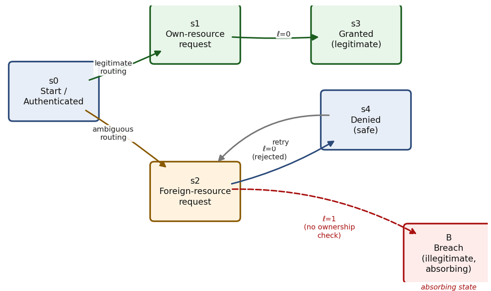

# Масштабування вразливостей IDOR у розробці ПЗ за допомогою ШІ: проблеми та шляхи вирішення

---

## Анотація

Insecure Direct Object Reference (IDOR) залишається однією з найстійкіших вразливостей порушеного контролю доступу у вебзастосунках та API. Зростання використання інструментів генерації коду на основі великих мовних моделей (LLM) не створило цей клас вразливостей, а пришвидшило його відтворення у продакшн-кодовій базі. У статті стверджується, що спостережуване зростання кількості IDOR-вразливого коду краще пояснюється двома взаємопов'язаними, переважно організаційними чинниками, ніж нібито "гіршою якістю" генерації коду ШІ як такою: статистичним успадкуванням небезпечних патернів доступу до об'єктів з публічних репозіторіїв коду, та фрагментацією володіння бізнес-логікою в сучасних  командах розробки, де ні окремі розробники, ні ШІ-асистенти, що працюють у межах вузького промпт-контексту, зазвичай не мають повного уявлення про наскрізні вимоги авторизації. Мета дослідження - проаналізувати ці першопричини, оцінити гарантії та обмеження двох існуючих архітектурних підходів до пом'якшення ризику: Row-Level Security (RLS) та Policy-as-Code (PaC),  і запропонувати дискретну марковську модель, яка формально описує легітимні й нелегітимні переходи станів у бізнес-процесі незалежно від конкретної реалізації коду. Розглянуто застосовність властивості відсутності пам'яті для цього класу бізнес-процесів, а також умови, за яких необхідні розширення вищого порядку чи напівмарковські моделі. Запропонована модель покликана доповнювати, а не замінювати, наявні засоби захисту на рівні коду та бази даних, підтримуючи ймовірнісну оцінку ризику та інтеграцію з інфраструктурою моніторингу SIEM/IDS.

**Ключові слова:** IDOR; порушений контроль доступу; генерація коду за участю ШІ; великі мовні моделі; Row-Level Security; Policy-as-Code; марковські моделі; моделювання бізнес-процесів; виявлення вторгнень.

---

## 1. Вступ

Порушений контроль доступу залишається найпоширенішою категорією вразливостей у продакшн-вебзастосунках упродовж кількох останніх редакцій OWASP Top 10, причому IDOR - формально каталогізований як CWE-639, Authorization Bypass Through User-Controlled Key - є одним із найчастіше експлуатованих його проявів [1, 3]. Для API окремо виділена споріднена вразливість, Broken Object Level Authorization, послідовно займає перше місце в OWASP API Security Top 10 [2]. Ці рейтинги існували більш ніж за десятиліття до появи LLM-асистентів кодування, що вказує: цей клас вразливостей не новий і не є специфічним саме для розробки за участю ШІ.

Швидке поширення інструментів генерації коду на основі LLM - плагінів для IDE, розмовних асистентів кодування, дедалі автономніших агентів - водночас змінило швидкість, з якою застосунковий код, включно з кодом, чутливим до авторизації, створюється та потрапляє в продакшн. Емпіричні дослідження фіксують вимірювані ефекти: Pearce та співавт. виявили, що значна частка коду, запропонованого GitHub Copilot у сценаріях, пов'язаних із безпекою, за оцінкою відповідно до стандартного переліку класів вразливостей, виявилася експлуатованою [5]. Perry та співавт. показали, що розробники, які користувалися ШІ-асистентом, частіше вносили вразливості в кількох завданнях і, що важливо, частіше оцінювали власний небезпечний код як безпечний порівняно з контрольною групою [6]. Sandoval та співавт. зафіксували подібний ефект надмірної впевненості для коду, чутливого до безпеки роботи з пам'яттю [7]. Разом ці результати описують ефект накопичення - швидша генерація коду в поєднанні зі зниженою критичною перевіркою, тобто це не якісно новий клас вразливостей.

У цій статті стверджується, що зростання кількості IDOR-вразливого коду точніше пояснюється двома взаємопов'язаними, переважно організаційними механізмами: (i) статистичним успадкуванням небезпечних патернів доступу до об'єктів, уже присутніх у публічних кодових корпусах, на яких навчаються генеративні моделі, та (ii) структурною фрагментацією володіння бізнес-логікою, характерною для сучасних команд розробки ПЗ, де жоден окремий учасник - людина чи ШІ-асистент - зазвичай не має повної видимості наскрізних вимог авторизації для конкретного ресурсу. Другий механізм у важливому сенсі не можна віднести на рахунок недбалості окремого розробника: кожен учасник зазвичай відповідає за чітко визначений модуль, сервіс чи ендпоїнт, тоді як відносини власності, які потрібно забезпечити на цьому ендпоїнті, часто залежать від бізнес-правил, що належать іншій команді, закодовані в іншому сервісі або просто не задокументовані в місці реалізації ендпоїнта. ШІ-асистент кодування успадковує це саме обмеження в підсиленій формі, оскільки його ефективний контекст обмежений поточним промптом - вужчим, ніж інституційні знання, доступні досвідченому члену команди.

Мета дослідження подвійна: по-перше, проаналізувати механізми успадкування та масштабування IDOR у конвеєрах розробки за участю ШІ, а також ефективність і обмеження двох наявних архітектурних підходів - Row-Level Security (RLS) та Policy-as-Code (PaC); по-друге, запропонувати й обґрунтувати марковську модель, здатну описувати легітимні й нелегітимні переходи доступу в бізнес-процесі на рівні абстракції, незалежному від конкретної реалізації коду. Для досягнення цієї мети вирішуються такі завдання:

1) виявити механізми успадкування з датасету та фрагментації бізнес-логіки, які масштабують IDOR;
2) проаналізувати гарантії та обмеження RLS і PaC як взаємодоповнюючих механізмів захисту;
3) формально визначити дискретний марковський ланцюг переходів станів доступу з поглинальним станом, що представляє нелегітимний перехід;
4) дослідити застосовність марковського припущення та умови, за яких потрібні розширення вищого порядку;
5) обговорити інтеграцію з інфраструктурою IDS/IPS/SIEM.

Розділ 2 розглядає суміжні роботи; розділ 3 аналізує першопричини масштабування IDOR; розділ 4 оцінює RLS і PaC; розділ 5 представляє запропоновану марковську модель; розділ 6 обговорює інтеграцію з моніторингом та обмеження; розділ 7 підсумовує й окреслює напрями подальших досліджень.

---

## 2. Суміжні роботи

Порушений контроль доступу, і зокрема IDOR, - давно досліджуваний клас вразливостей. OWASP відстежує його як найвищу за рейтингом категорію ризику для вебзастосунків з 2021 року [1] і як найвищу за рейтингом специфічну для API вразливість з 2019 року, що востаннє підтверджено в редакції API Security Top 10 2023 року [2]. MITRE Common Weakness Enumeration надає формальне визначення, використане в цій статті: CWE-639 описує систему, яка використовує наданий користувачем ключ для прямого доступу до ресурсу, без перевірки того, що запитувач авторизований для доступу саме до цього ресурсу [3].

Окремий, новіший масив робіт досліджує властивості безпеки коду, згенерованого LLM. Окрім досліджень, розглянутих у розділі 1 [5–7], OWASP підтримує окремий Top 10 for Large Language Model Applications, що охоплює ризики надмірної довіри до виводу моделі, включно з небезпечним згенерованим кодом [4]. Висновком з огляду ціх матеріалів можна вважати, що жодна з цих робіт не розкладає ШІ-складову масштабування IDOR на компонент успадкування з датасету й організаційний компонент фрагментації; більшість трактувань неявно приписують ефект самій генеративній моделі.

Щодо механізмів усунення (протидії): семантика RLS для PostgreSQL визначена в офіційній документації [8], з відомою взаємодією із проміжним ПЗ пулінгу з'єднань, таким як pgBouncer [9]. Фреймворки Policy-as-Code, такі як Open Policy Agent [10] та Amazon Cedar [11], узагальнюють модель авторизації, що походить від Google Zanzibar - першої широко відомої централізованої системи авторизації, що охоплює різнорідні сховища даних [12]. Застосування марковськіх моделей мають в дослідженнях кібербезпеки, зокрема у виявленні вторгнень через приховані марковські моделі над послідовностями системних викликів [16], а також у процес-майнінгу для журналів бізнес-процесів [15]; теорія поглинальних марковських ланцюгів, використана в розділі 5, спирається на класичний виклад Кемені та Снелла [14] та Норріса [13]. Інтеграція виявлення на основі аномалій та правил із платформами SIEM, до якої повертається розділ 6, розглядається в [17–20]. Ця стаття позиціонує себе на перетині цих напрямів: розглядає масштабування IDOR як явище успадкування-і-фрагментації, а не дефект моделі, оцінює наявні механізми усунення (портидфї) відповідно до наведеного вище тверджень, та пропонує стохастичну формалізацію саме для такої інфраструктури моніторингу.

---

## 3. Першопричини масштабування IDOR у розробці за участю ШІ

### 3.1. Статистичне успадкування з публічних репозіторіїв

Генеративна модель коду відтворює статистичний розподіл патернів, наявних у публічних репозіторіях. У таких репозиторіях - непропорційно часто в туторіалах та коротких ілюстративних прикладах - перевірка власності, яка мала б супроводжувати прямий доступ до об'єкта (предикат над парою `id, власник_id`, а не лише `id`), зазвичай опускається заради стислості, тоді як сама вибірка за ідентифікатором зберігається, оскільки саме вона демонструє можливість фреймворку, що документується. Це не унікальна властивість LLM: це той самий механізм, через який розробники десятиліттями відтворювали IDOR, адаптуючи приклад без коригування під власну модель авторизації. З впровадженням LLM-генерації змінюється пропускна здатність - той самий патерн без перевірки власності тепер може відтворюватися на багатьох ендпоїнтах за частку часу, потрібного розробнику-людині, щоб розробити еквівалентний код власноруч.

### 3.2. Фрагментація володіння бізнес-логікою

Другий, доповнювальний механізм - організаційний, а не статистичний. Сучасні програмні системи, як правило, декомпозовані на обмежені контексти чи сервіси, кожен з яких належить окремій команді, за тим самим принципом розподілу відповідальності, що лежить в основі domain-driven design та мікросервісних архітектур. Ця декомпозиція сама по собі не є дефектом, але має побічний ефект, що безпосередньо стосується IDOR: вимога авторизації для ресурсу ("лише орендар-власник або користувач із делегованою роллю може читати цей рахунок") - це наскрізне правило, яке часто походить поза межами модуля, що реалізує ендпоїнт. Розробник, відповідальний за ендпоїнт, може знати схему ресурсу та синтаксис запитів фреймворку, не маючи при цьому повного й актуального знання про кожне легітимне правило делегування. Саме тому отримані вразливості, у важливому сенсі, не можна віднести на рахунок індивідуальної недбалості: правило авторизації, яке розробнику потрібно було б реалізувати, часто належить іншим або документується деінде. ШІ-асистент успадковує це обмеження в підсиленій формі, оскільки його ефективний контекст обмежений поточним промптом, вужчим за інституційні знання досвідченого члена команди - що робить і розробника-людину, і асистента схильними згенерувати ендпоїнт, працездатний як для легітимного, так і для нелегітимного запитів.


### 3.3. Ілюстративний вразливий патерн

Патерн, що виникає внаслідок обох механізмів разом, структурно простий і повторюється в різних мовах і фреймворках. Маршрут на зразок

```
GET /api/v1/report/{report_id}
```

приймає ідентифікатор ресурсу; обробник виконує прямий пошук, наприклад

```
report = db.fetch(report_id)
```

без фільтрації за `tenant_id` чи `власник_id`; відповідь серіалізується й повертається, щойно запис із таким ідентифікатором існує в базі. Перевіряється синтаксична коректність ідентифікатора (наприклад, що він парситься як UUID), а не право запитувача на доступ саме до цього запису. Оскільки цей патерн синтаксично невідрізнимий від коректно авторизованого аналога, він, як правило, проходить функціональне тестування, код-рев'ю, зосереджене на бізнес-логіці, і статичну перевірку типів - жодне з яких не розраховане на аналіз відносин власності між запитами.

---

## 4. Наявні архітектурні механізми усунення (протидії) та їх обмеження

### 4.1. Row-Level Security

Row-Level Security (RLS) переносить перевірку власності з рівня застосунку безпосередньо в СУБД. Після ввімкнення RLS на таблиці й прив'язки ідентифікатора користувача до сесії, СУБД прозоро додає предикат власності до кожного запиту проти цієї таблиці, незалежно від того, чи пам'ятав викликаючий код включити його:

```
ALTER TABLE invoices ENABLE ROW LEVEL SECURITY;
```

а після встановлення контексту сесії через налаштування на зразок `app.current_user_id`:

```
CREATE POLICY invoice_власникship ON invoices
USING (власник_id = current_setting('app.current_user_id')::uuid)
```

Явне приведення типу до `uuid` необхідне, оскільки `current_setting()` у PostgreSQL завжди повертає значення типу `text` [8]; пропуск цього приведення або спричиняє помилку типу, або, залежно від версії й типу стовпця, мовчки не фільтрує так, як передбачалося, що зводить нанівець мету політики. Увімкнений таким чином механізм ефективний саме проти класу помилки, описаного в п. 3.3: навіть якщо викликаючий код повністю пропускає `WHERE власник_id = ...`, база даних автоматично додає еквівалентний предикат.

RLS, однак, не є універсальним рішенням. По-перше, він не захищає від помилок у самій політиці авторизації - некоректно змодельоване правило делегування залишається вразливим незалежно від того, виражене воно в коді застосунку чи в SQL-предикаті; RLS переміщує помилку, описану в п. 3.1–3.2, а не усуває її. По-друге, RLS залежить від налаштування, прив'язаного до сесії, яке має коректно скидатися проміжним ПЗ пулінгу з'єднань: у режимі transaction-mode пулінгу з'єднання може повертатися в пул і повторно використовуватися іншим користувачом, і якщо налаштування не скидається, наступний, непов'язаний запит може успадкувати авторизаційний контекст попередньої сесії [9]. По-третє, неявний предикат на кожному рядку може впливати на здатність планувальника запитів ефективно використовувати індекси в масштабі, і породжує "тиху відмову": запит, заблокований політикою, повертає нуль рядків замість явної відповіді "403", що невідрізнимо від запиту до ресурсу, який просто не існує - ускладнюючи як відладку, так і виявлення активних спроб експлуатації.

### 4.2. Policy-as-Code

Policy-as-Code (PaC) використовує доповнювальний підхід, виносячи логіку авторизації в окремий сервіс, до якого застосунок звертається явно в момент прийняття рішення. Системи на зразок Open Policy Agent [10] та Amazon Cedar [11] реалізують цю модель через декларативну мову політик, спираючись на архітектурну спадщину Google Zanzibar, яка продемонструвала централізовану, горизонтально масштабовану службу авторизації для різнорідних сховищ даних [12]. Оскільки рушій політик відокремлений від конкретного сховища даних, один набір правил може, в принципі, керувати доступом одночасно до реляційних баз, документних сховищ та об'єктного сховища - чого RLS, обмежений реляційним рушієм, що його виконує, не може.

Головне обмеження PaC - дзеркальне до головної сили RLS. RLS застосовується автоматично для кожного запиту до захищеної таблиці, незалежно від того, чи пам'ятає викликаючий код про це. Перевірка Policy-as-Code, навпаки, має бути явно викликана застосунком у правильній точці шляху обробки запиту - зазвичай виклик виду:

```
if not policy_engine.allow(subject, action, resource): return 403
```

Якщо цей виклик пропущено - розробником-людиною чи ШІ-асистентом, що генерує відповідний обробник - захист повністю обходиться, і жодного захисту на рівні бази даних не лишається, щоб перехопити цей пропуск. Це той самий клас "забутої перевірки", описаний у розділі 3, тож PaC сам по собі не закриває прогалину, що мотивула на створення цієї статті; він переносить точку, де може статися пропуск, з рівня запиту до бази на рівень обробки запиту застосунком, не усуваючи можливості пропуску.

### 4.3. Порівняльні підсумки

| Критерій | Row-Level Security | Policy-as-Code |
|---|---|---|
| Точка застосування | Рушій СУБД (автоматично на кожен запит) | Рівень застосунку/сервісу (явний виклик) |
| Режим відмови при пропуску | Не застосовно - політика прив'язана до таблиці, а не до точки виклику | Повністю обходиться, якщо виклик пропущено |
| Охоплення різних сховищ | Обмежено СУБД, що виконує політику | Охоплює різнорідні сховища даних |
| Типові накладні витрати | Обчислення предиката на кожен рядок | Мережевий/IPC-виклик на кожне рішення |
| Зручність відладки | "Тиха відмова" (0 рядків, без 403) | Явна відмова, централізовано логується |
| Ризик пулінгу з'єднань | Витік контексту сесії в transaction-mode пулінгу | Не застосовно (виклики рішень без стану) |

Жоден із механізмів не є панацеєю, і вони не є взаємовиключними: RLS добре підходить для закриття автоматичного режиму відмови "забули WHERE" для обмеженого набору критичних таблиць в одній базі даних, тоді як PaC краще підходить для вираження й централізованого аудиту складних наскрізних правил у кількох сховищах даних - ціною залежності від дисциплінованого явного виклику. Ця взаємодоповнюваність, а також той факт, що обидва механізми залишаються превентивними засобами контролю на рівні коду чи схеми, а не засобами моніторингу, надає обгрунтовану потребу у створенні моделі виявлення нелегітимних переходів на рівні процесу, запропоновану в розділі 5.

---

## 5. Марковська модель переходів доступу

### 5.1. Мотивація

Розділи 3 і 4 встановлюють, що IDOR-небезпечний код генерується з системних причин, і що обидва домінантні архітектурні механізми залишаються неповними самі по собі. Це сприяє створенню доповнювального рівня виявлення(детекції): формальний, незалежний від коду опис того, як бізнес-процес переміщується між станами, релевантними для авторизації, який можна оцінювати проти журналів запитів незалежно від того, яка комбінація превентивних механізмів - RLS, PaC, обидва чи жоден - розгорнута під ним. Пропонується моделювати цей процес як дискретний марковський ланцюг (DTMC), що дозволяє виразити ризик нелегітимного переходу як імовірність та очікуваний час до настання - обидва показники безпосередньо придатні як вхідні дані для систем моніторингу (розділ 6).

### 5.2. Формальне визначення

Нехай взаємодія на рівні запиту між автентифікованим користувачем і захищеним ресурсом представлена дискретним стохастичним процесом {X_t, t = 0, 1, 2, …} над скінченним простором станів S. Визначимо невеликий ілюстративний простір станів S = {s0, s1, s2, s3, s4, B} для одного рішення про доступ до ресурсу в межах ширшого бізнес-процесу (рис. 1):

- **s0** - автентифікований користувач, до запиту на доступ до ресурсу;
- **s1** - запит на ресурс, яким користувач легітимно володіє;
- **s2** - запит на ідентифікатор ресурсу, що не належить користувачу (стан, у якому стає можливою спроба IDOR - навмисна або через повторне використання застарілого чи вгаданого ідентифікатора на боці клієнта);
- **s3** - доступ надано до власного ресурсу (легітимний результат);
- **s4** - доступ відхилено коректно працюючою перевіркою авторизації (безпечний результат);
- **B** - доступ надано до чужого ресурсу за відсутності дійсного дозволу - нелегітимний результат, що й є проявом IDOR, змодельований як поглинальний стан.



**[Рис. 1 - діаграма переходів станів.  Пунктирна дуга s2 → B позначає єдиний нелегітимний перехід; B - поглинальний.]**

Нехай P = [p_ij] - матриця ймовірностей переходу за один крок розміром |S| × |S|, p_ij = Pr(X_{t+1} = j | X_t = i). Розіб'ємо множину напрямлених ребер ланцюга на легітимну підмножину E_L та нелегітимну підмножину E_I за допомогою індикаторної функції ℓ(i, j):

**(5)** ℓ(i, j) = 1, якщо й лише якщо власник(об'єкт, до якого звертаються в j) ≠ principal(сесія) і жоден дійсний дозвіл не авторизує цей доступ; ℓ(i, j) = 0 в іншому випадку.

Для ілюстративного ланцюга на рис. 1 єдине ребро з ℓ = 1 - це (s2, B); усі інші ребра або легітимні, або безпечно відхиляються за побудовою.

Оскільки B - єдиний поглинальний стан, релевантний для оцінки ризику, ланцюг можна записати в канонічній блоковій формі над перехідними станами T = {s0, s1, s2, s3, s4} та поглинальним станом B:

**(6)** P = [ Q  R ; 0  1 ]

де Q - підматриця |T| × |T| ймовірностей переходів між перехідними станами, R - вектор |T| × 1 ймовірностей переходу за один крок з кожного перехідного стану безпосередньо в B, 0 - нульовий рядок 1 × |T|, а 1 - скалярна ймовірність самопереходу поглинального стану. Стандартна теорія поглинальних марковських ланцюгів [13, 14] дає фундаментальну матрицю:

**(7)** N = (I − Q)⁻¹

елемент якої N_ij дає очікувану кількість відвідувань перехідного стану j до поглинання, починаючи зі стану i. Звідси безпосередньо випливають очікувана кількість кроків до поглинання та ймовірність того, що поглинання станеться саме в стані-порушенні B, а не в безпечному термінальному стані:

**(8)** t = N · 1

**(9)** b = N · R

де 1 - вектор з одиниць, а b - вектор, i-тий елемент якого, b_i, дає ймовірність того, що процес, який починається в перехідному стані i, зрештою поглинається нелегітимним станом B, а не безпечним термінальним станом, за поточної матриці переходів P. Обидва показники, t і b, можна оцінювати за класами ресурсів, ендпоїнтами чи орендарями з журналів доступу, і обидва можна моніторити в часі як випереджальний індикатор виникнення експозиції IDOR - незалежно від того, чи був переглянутий базовий код.

### 5.3. Застосовність марковської властивості

Формалізація вище спирається на припущення про відсутність пам'яті (властивість Марковських процесів): розподіл X_{t+1} залежить лише від поточного стану X_t, а не від усієї передісторії X_0, …, X_{t-1}. Чи виправдане це припущення, залежить від того, що саме генерує наступний стан - сам бізнес-процес чи адаптивний запитувач, що його зондує - і від деталізації, на якій визначено стан. За стандартної, орієнтованої на окремий запит моделі авторизації, типової для REST і JWT-базованих API - де кожен запит оцінюється рівнем авторизації незалежно від конкретної послідовності попередніх запитів у тій самій сесії - це розумне наближення першого порядку, оскільки рішення про авторизацію за задумом має залежати лише від поточної трійки (суб'єкт, ресурс, роль), а не від історії запитів. Якщо змодельований стан додатково кодує позицію в багатокроковому бізнес-процесі (наприклад, рахунок, що проходить через створення → погодження → оплату), марковська властивість продовжує виконуватися за побудовою щодо вимірювання самого процесу, за умови що сам процес визначено як скінченно-стан процес, у якому набір допустимих наступних кроків залежить лише від поточного кроку - стандартне припущення, що лежить в основі моделювання бізнес-процесів і процес-майнінгу загалом [15].

Це припущення більш крихке на рівні адаптивного зловмисника. Кампанія перебору ідентифікаторів (IDOR enumeration), у якій наступні здогадки ідентифікатора обираються на основі результату попередніх запитів, залежна від історії з точки зору зловмисника, навіть якщо кожне окреме рішення про авторизацію, ухвалене системою, саме по собі позбавлене пам'яті. Тому виокремлюються дві різні цілі моделювання: рішення системи про авторизацію на рівні окремого запиту, для якого припущення марковості першого порядку в рівняннях (5)–(9) є обґрунтованим, та стратегія вибору запитів самого запитувача, для якої більш доречна напівмарковська модель (щоб врахувати негеометричний розподіл часу між зондувальними запитами) або прихована марковська модель (де спостережувана послідовність HTTP-відповідей обмежує висновок про неспостережуваний бінарний стан наміру - легітимний/зловмисний), 
за прецедентом Warrender, Forrest та Pearlmutter для виявлення вторгнень на основі послідовностей [16].

### 5.4. Шлях до емпіричної валідації

Модель у п. 5.2 наразі є формальною специфікацією, а не валідованим інструментом, що вважається головним пунктом подальшої роботи (розділ 7). Практичний протокол валідації складається з трьох кроків: оцінити частоти переходів із кортежів журналів доступу виду (сесія, ресурс, збіг власника, крок процесу, часова мітка), згрупованих за класом ресурсу чи ендпоїнтом, щоб отримати емпіричну матрицю P̂; перевірити саме припущення марковості першого порядку статистично - наприклад, тестом відношення правдоподібностей (хі-квадрат), що порівнює модель першого порядку з моделлю другого порядку, відхилення якого запускає напівмарковське/HMM-розширення з п. 5.3; і перевірити підігнані оцінки t і b (рівн. 8–9) на відомих інцидентах чи синтетично введених IDOR-зондах, щоб відкалібрувати практичний поріг сповіщення.

---

## 6. Обговорення

Запропонована в розділі 5 марковська модель задумана як засіб виявлення на рівні моніторингу, що доповнює превентивні механізми з розділу 4, а не замінює жоден з них. На практиці показники t і b (рівн. 8–9) можна періодично перераховувати за класом ресурсу з продакшн-журналів доступу й подавати як ознаки для конвеєра виявлення аномалій, у дусі інтеграції з SIEM, розглянутої в [17, 18]. Це частково вирішує задокументовану складність систем виявлення вторгнень на основі аномалій: високий рівень хибних спрацьовувань на початковому етапі впровадження через відсутність принципового пріора для того, що вважати незвичайною поведінкою [20]. Імовірність нелегітимного поглинання b_i, оцінена зі структури самого бізнес-процесу, а не лише зі статистичних викидів у сирих ознаках трафіку, є саме таким пріором, який можна поєднувати із сигнатурним та аномальним виявленням за тією самою логікою комбінованих методів, що аргументована для виявлення вторгнень загалом у [19, 20].

Слід явно зазначити два обмеження. По-перше, модель потребує журналів доступу достатньої якості й обсягу для надійної оцінки P̂; щойно розгорнутий ендпоїнт стикається з тією самою проблемою "холодного старту", знайомою для виявлення на основі аномалій загалом [18, 20]. По-друге, ілюстративний простір станів на рис. 1 свідомо невеликий; продакшн-впровадження з багатьма типами ресурсів ризикує вибуховим зростанням простору станів, якщо кожен ідентифікатор моделювати окремо. Пропонується агрегувати ресурси за класом, орендарем чи роллю - той самий рівень деталізації, на якому вже зазвичай виражені правила RLS і PaC - що тримає простір станів обмеженим і узгоджує рівень моніторингу з превентивними механізмами, які він доповнює.

---

## 7. Висновки

У статті розглянуто Insecure Direct Object Reference (IDOR) у контексті розробки програмного забезпечення за участю ШІ, і аргументовано, що його видиме зростання точніше пояснюється масштабуванням давно наявного, успадкованого з датасету патерну, посиленого структурною фрагментацією володіння бізнес-логікою в командах розробки, ніж дефектом, специфічним для генеративних моделей коду. Це переформулювання важливе, оскільки зміщує фокус коригувальних заходів з поведінки окремого розробника на організаційні та архітектурні механізми контролю.

Row-Level Security та Policy-as-Code проаналізовано як взаємодоповнювальні, а не взаємозамінні механізми: RLS автоматично застосовує предикат власності, але обмежений однією базою даних і вразливий до витоку сесійного контексту через пулінг з'єднань та складнощів відладки через "тиху відмову"; PaC узагальнюється на різнорідні сховища даних, але залежить від явного виклику, який можна пропустити тим самим механізмом, що породжує саму вразливість IDOR. Жоден з механізмів не усуває потреби в моніторинговому погляді на те, як бізнес-процес насправді поводиться в продакшні.

Для цього запропоновано дискретний марковський ланцюг переходів станів доступу з поглинальним станом, що представляє нелегітимний (IDOR) перехід, і виведено замкнені вирази для очікуваного часу до такого переходу та його ймовірності на основі стандартної теорії поглинальних марковських ланцюгів. Показано, що припущення про відсутність пам'яті обґрунтоване для рішень авторизації на рівні окремого запиту та для переходів позиції в бізнес-процесі, визначеному як скінченно-стан процес, але потребує напівмарковського чи прихованого марковського розширення, щоб коректно врахувати залежну від історії стратегію зондування адаптивного запитувача.

Подальша робота має пріоритизувати: (i) емпіричне підгонку й валідацію моделі на реальних журналах доступу, включно зі статистичною перевіркою самого припущення марковості першого порядку; (ii) розробку напівмарковського/прихованого марковського розширення з п. 5.3 та оцінку його додаткової точності виявлення; (iii) інтеграцію ймовірнісних результатів моделі в операційний конвеєр IDS/SIEM та вимірювання зниження частки хибних спрацьовувань; (iv) контрольоване порівняння частоти IDOR у коді, створеному з та без участі ШІ за узгоджених умов, щоб відокремити ефект успадкування з датасету від організаційного ефекту, виявленого в розділі 3.

---

## Список джерел 

1. OWASP Foundation: A01:2021 – Broken Access Control. OWASP Top 10:2021, https://owasp.org/Top10/A01_2021-Broken_Access_Control/ (2021).
2. OWASP Foundation: API1:2023 Broken Object Level Authorization. OWASP API Security Top 10:2023, https://owasp.org/API-Security/editions/2023/en/0x11-t10/ (2023).
3. MITRE Corporation: CWE-639: Authorization Bypass Through User-Controlled Key. Common Weakness Enumeration, https://cwe.mitre.org/data/definitions/639.html.
4. OWASP Foundation: OWASP Top 10 for Large Language Model Applications, v1.1. https://owasp.org/www-project-top-10-for-large-language-model-applications/ (2024).
5. Pearce, H., Ahmad, B., Tan, B., Dolan-Gavitt, B., Karri, R.: Asleep at the keyboard? Assessing the security of GitHub Copilot's code contributions. In: IEEE Symposium on Security and Privacy (S&P 2022), pp. 754–768 (2022).
6. Perry, N., Srivastava, M., Kumar, D., Boneh, D.: Do users write more insecure code with AI assistants? In: ACM SIGSAC Conference on Computer and Communications Security (CCS 2023), pp. 2785–2799 (2023).
7. Sandoval, G., Pearce, H., Nys, T., Karri, R., Garg, S., Dolan-Gavitt, B.: Lost at C: a user study on the security implications of large language model code assistants. In: 32nd USENIX Security Symposium (2023).
8. PostgreSQL Global Development Group: Row Security Policies. PostgreSQL Documentation, https://www.postgresql.org/docs/current/ddl-rowsecurity.html.
9. PgBouncer Project: Pool modes. PgBouncer Documentation, https://www.pgbouncer.org/config.html.
10. Open Policy Agent: Documentation. Cloud Native Computing Foundation, https://www.openpolicyagent.org/docs/latest/.
11. Amazon Web Services: Cedar Policy Language Reference Guide. https://docs.cedarpolicy.com/.
12. Pang, R., Caceres, R., Burrows, M., et al.: Zanzibar: Google's consistent, global authorization system. In: USENIX Annual Technical Conference (ATC 2019), pp. 33–46 (2019).
13. Norris, J.R.: Markov Chains. Cambridge University Press, Cambridge (1997).
14. Kemeny, J.G., Snell, J.L.: Finite Markov Chains. Springer, New York (1976).
15. van der Aalst, W.M.P.: Process Mining: Data Science in Action, 2nd edn. Springer, Heidelberg (2016).
16. Warrender, C., Forrest, S., Pearlmutter, B.: Detecting intrusions using system calls: alternative data models. In: IEEE Symposium on Security and Privacy, pp. 133–145 (1999).
17. González-Granadillo, G., González-Zarzosa, S., Diaz, R.: Security information and event management (SIEM): analysis, trends, and usage in critical infrastructures. Sensors 21(14), 4759 (2021).
18. Nassif, A.B., Talib, M.A., Nasir, Q., Dakalbab, F.M.: Machine learning for anomaly detection: a systematic review. IEEE Access 9, 78658–78700 (2021).
19. Hindy, H., Brosset, D., Bayne, E., Seeam, A.K., Tachtatzis, C., Atkinson, R., Bellekens, X.: A taxonomy of network threats and the effect of current datasets on intrusion detection systems. IEEE Access 8, 104650–104675 (2020).
20. Tetskyi, A., Uzun, D.: Intrusion detection and prevention systems as a component of ensuring compliance with regulatory documents. Radioelectronic and Computer Systems, no. 3(111), pp. 166–174 (2024). doi:10.32620/reks.2024.3.11.

---

## Ще роботи, які вже були опубліковані, так би мовити історічний контекст: 

### Tetskyi, Kharchenko, Uzun - Analysis of the Possibilities of Unauthorized Access in Content Management Systems Using Attack Trees (2018) - досліджувалися сценарії несанкціонованого доступу до CMS та ймовірність успішної атаки з використанням attack trees, результатів аудиту й аналізу вихідного коду.

### Strielkina, Kharchenko, Uzun - A Markov Model of Healthcare Internet of Things System Considering Failures of Components (2018) - тут уже безпосередньо з'являється марковське моделювання IoT-систем.

### Strielkina, Uzun, Kharchenko - Availability Models for Healthcare IoT Systems: Classification and Research Considering Attacks on Vulnerabilities (2018) - безпосередньо розглядається вплив атак на вразливості.

### Kharchenko et al., Uzun - Availability Model of Two-Zone Physical Security System Considering Cyber Attacks and Software Update (DESSERT 2020) - моделюється вплив cyber attacks та оновлення ПЗ на стан системи.

### Tetskyi, Kharchenko, Uzun, Nechausov - Architecture and Model of Neural Network Based Service for Choice of the Penetration Testing Tools (2021) - уже присутній автоматизований вибір засобів penetration testing.

--- 

